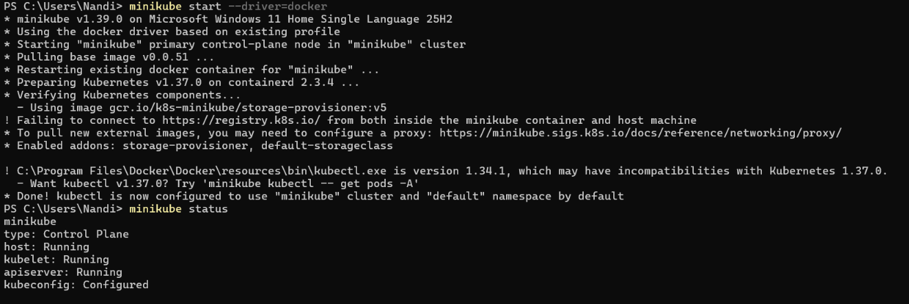
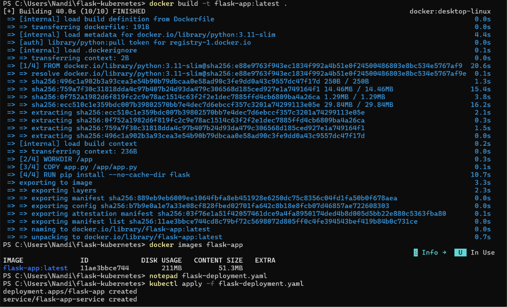
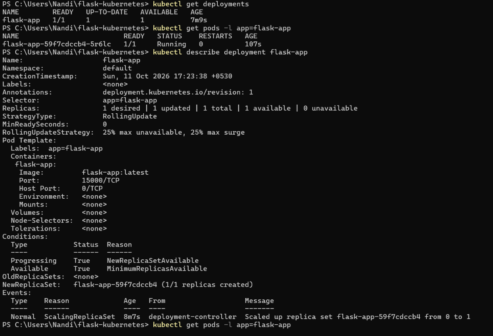
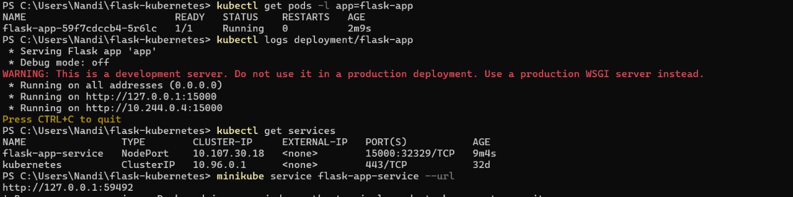
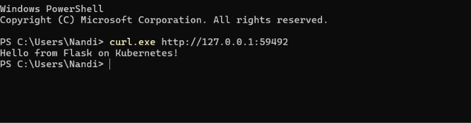

# Kubernetes Basics with Minikube — Flask App Deployment

## 1. Starting Minikube

Started Minikube using Docker Desktop as the driver. The first startup displayed a warning that the Kubernetes image registry could not be reached, but the cluster started successfully.

Verified that the Minikube control plane, host, kubelet, and API server were running and that the Kubernetes configuration was set up correctly.

---

## 2. Building the Flask Docker Image

Created a simple Flask application and packaged it into a Docker image named `flask-app:latest`.

The image build completed successfully using Docker Desktop. The image was then checked to confirm that it was available locally.

---

## 3. Deploying the Application to Kubernetes

Created a Kubernetes configuration file defining the Flask Deployment and its Service, then applied it to the Minikube cluster.

Initially, the Pod could not find the local image. This was resolved by loading the image into Minikube and recreating the Pod.

The final Deployment showed one desired replica, one updated replica, and one available replica. The Flask Pod reached the `Running` state with zero restarts.

---

## 4. Checking Application Logs

Inspected the Deployment and application logs to confirm that Flask had started successfully and was listening on port `15000`.

The logs showed that the Flask development server was running inside the Kubernetes Pod.

---

## 5. Exposing the Application with a Service

Created a Kubernetes NodePort Service named `flask-app-service`. The Service routes traffic from port `15000` to port `15000` in the Flask container.

Verified the Service configuration and used Minikube to obtain a URL accessible from the Windows host.

---

## 6. Accessing the Flask Application

Used the URL provided by Minikube to send a request to the application from PowerShell.

The request returned the expected response:

**Hello from Flask on Kubernetes!**

This confirmed that the request could reach the Flask application through the Kubernetes Service.

---

## Outcome

- Built a Docker image for a Flask application.
- Started a local Kubernetes cluster using Minikube and Docker Desktop.
- Deployed the application using a Kubernetes Deployment.
- Verified the Pod was running and the Deployment had one available replica.
- Inspected application logs and confirmed Flask was listening on port `15000`.
- Exposed the application through a NodePort Service and accessed it using the URL provided by Minikube.

## Key Takeaways

| Concept | What it does |
|---|---|
| Docker image | Packages the Flask application and its dependencies. |
| Minikube | Runs a local Kubernetes cluster for learning and testing. |
| Deployment | Maintains the desired number of application replicas. |
| Pod | Runs the application container managed by Kubernetes. |
| ReplicaSet | Ensures the required number of Pods are maintained. |
| Service | Provides a stable way to route requests to the application Pod. |
| `imagePullPolicy: Never` | Uses an image already available on the Kubernetes node. |
| `minikube service --url` | Provides a URL for accessing the Service from the host in this setup. |
