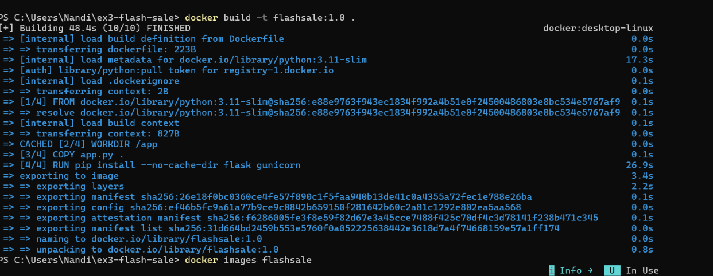
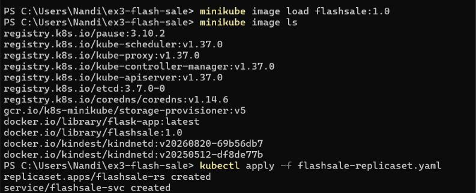
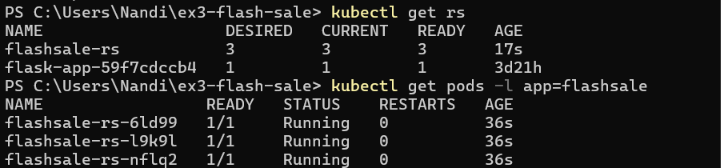
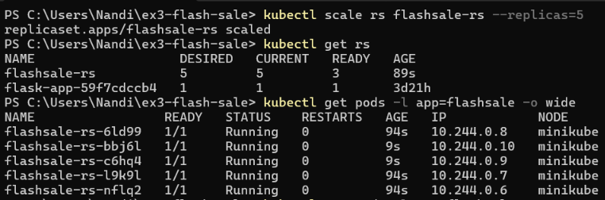
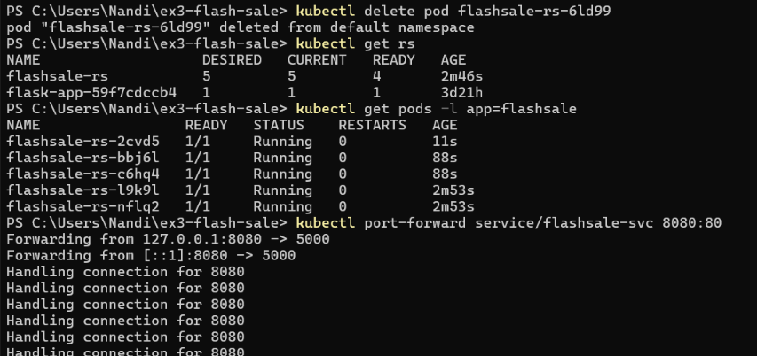
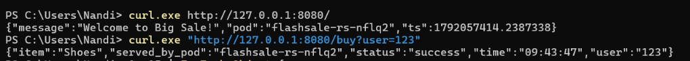

# Exercise 3: Scaling Flask App on a Single Node Using ReplicaSets

## Objective

This exercise demonstrates how Kubernetes ReplicaSets maintain a desired number of Pods, how to scale an application from three to five replicas, and how Kubernetes replaces a Pod that is deleted.

The Flask application simulates a simple e-commerce flash sale. The `/` endpoint welcomes users, `/buy` returns a simulated purchase response, and the response includes the Pod hostname so that the Pod serving a request can be identified.

## 1. Build the Docker Image and Load It into Minikube

Built the application image with the tag `flashsale:1.0`:

```powershell
docker build -t flashsale:1.0 .
docker images flashsale
```

Loaded the image into Minikube so Kubernetes could use the local image:

```powershell
minikube image load flashsale:1.0
minikube image ls
```

The image list showed `docker.io/library/flashsale:1.0`, confirming that the image was available to the Minikube cluster.



## 2. Apply the ReplicaSet and Service

Applied the Kubernetes configuration:

```powershell
kubectl apply -f flashsale-replicaset.yaml
```

The command created:

- `flashsale-rs` — a ReplicaSet configured to maintain three Pods initially.
- `flashsale-svc` — a ClusterIP Service that selects Pods labelled `app: flashsale` and forwards traffic to container port `5000`.

Verified the initial ReplicaSet and Pods:

```powershell
kubectl get rs
kubectl get pods -l app=flashsale
```

The output showed three Pods, each with `1/1` ready and a `Running` status. The existing `flask-app` ReplicaSet shown in the terminal belongs to the earlier exercise; the flash-sale exercise uses `flashsale-rs`.



## 3. Scale the ReplicaSet from Three to Five Pods

Scaled the ReplicaSet to five replicas:

```powershell
kubectl scale rs flashsale-rs --replicas=5
```

Verified the updated ReplicaSet:

```powershell
kubectl get rs
```

Then inspected the Pods and their node placement:

```powershell
kubectl get pods -l app=flashsale -o wide
```

The ReplicaSet showed five desired replicas, and five Pods were running. The `NODE` column showed that all five Pods were scheduled on the single `minikube` node.



## 4. Delete a Pod and Observe Automatic Replacement

Deleted one of the flash-sale Pods:

```powershell
kubectl delete pod flashsale-rs-6ld99
```

The Pod name above is the one used in this run. Pod names are generated dynamically and may differ in another run.

Checked the ReplicaSet and Pods again:

```powershell
kubectl get rs
kubectl get pods -l app=flashsale
```

Kubernetes created a replacement Pod to restore the desired count of five. This demonstrates how the ReplicaSet continuously compares the actual number of matching Pods with the configured replica count and creates replacements when necessary.



## 5. Access the Application Through the Service

Started port forwarding from the local machine to the Kubernetes Service:

```powershell
kubectl port-forward service/flashsale-svc 8080:80
```

The terminal displayed forwarding from local port `8080` to Service port `80`, which forwards requests to the application container on port `5000`.

Kept this terminal open while testing the application from a separate PowerShell window.



## 6. Test the Flash-Sale Endpoints

Tested the homepage:

```powershell
curl.exe http://127.0.0.1:8080/
```

The response included the welcome message, the Pod hostname, and a timestamp.

Tested a simulated purchase:

```powershell
curl.exe "http://127.0.0.1:8080/buy?user=123"
```

The response returned a randomly selected item, the supplied user ID, a success status, the Pod that handled the request, and the response time.



## Results and Observations

- **Initial replica count:** 3 Pods.
- **Replica count after scaling:** 5 Pods.
- **Pod replacement:** After one Pod was deleted, the ReplicaSet created a replacement to return to five Pods.
- **Node distribution:** All five Pods ran on the single `minikube` node.
- **Service access:** The application was reachable locally through port forwarding to `flashsale-svc`.
- **Endpoint verification:** Both the homepage and `/buy` endpoint returned successful JSON responses, including the hostname of the Pod that handled the request.

## Key Learnings

| Kubernetes concept | Learning |
|---|---|
| ReplicaSet | Maintains the desired number of matching Pods. |
| Replicas | Scaling from 3 to 5 caused Kubernetes to create two additional Pods. |
| Self-healing | Deleting a Pod caused the ReplicaSet to create a replacement. |
| Labels and selectors | The Service uses the `app: flashsale` label to select the application Pods. |
| Service | Provides a stable endpoint for accessing the Pods. |
| Port forwarding | Made the application accessible locally at `http://127.0.0.1:8080`. |
| `kubectl get pods -o wide` | Displays Pod IPs and the node on which each Pod is running. |

## Conclusion

The exercise successfully demonstrated scaling a Flask application with a Kubernetes ReplicaSet on a single Minikube node. The ReplicaSet maintained three initial Pods, scaled to five Pods, and replaced a deleted Pod. The application was also accessed through a Kubernetes Service, and both the homepage and simulated purchase endpoint were tested successfully.

> Note: This is a local learning exercise. Running multiple Pods on one node demonstrates replica management, but it does not provide node-level high availability. The application simulates purchase responses and does not process real payments or persist orders.
