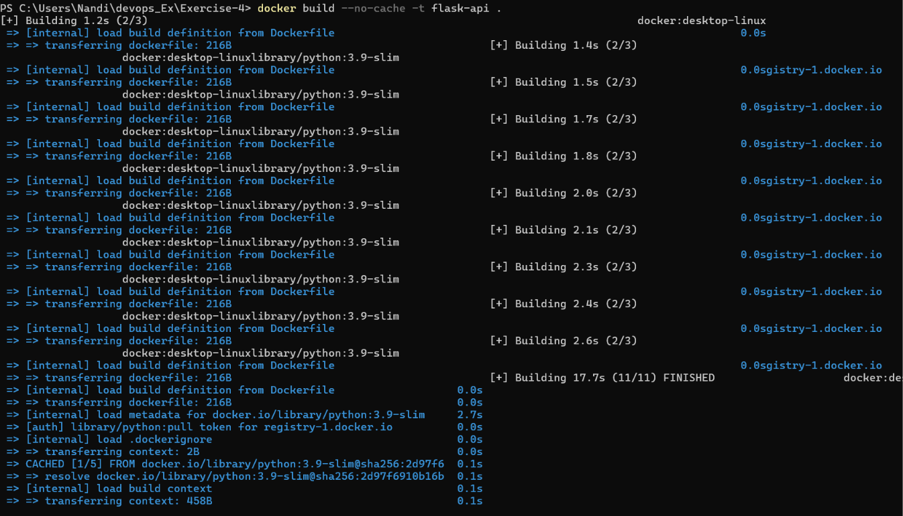
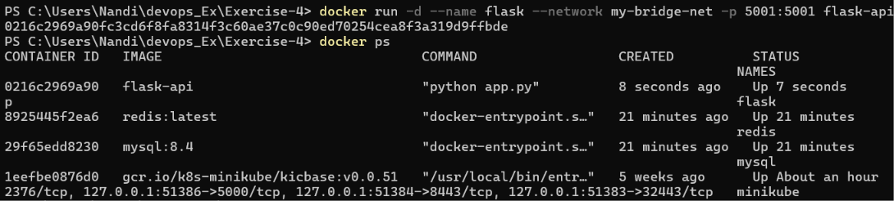
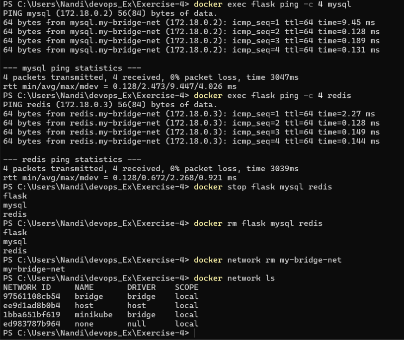

# Exercise 4: Docker Networking with Multiple Containers

## Objective

Understand Docker networking and configure a multi-container application consisting of:

- **Flask** — a Python web server
- **MySQL** — a database service
- **Redis** — a cache service

## Environment

- Docker Desktop using the Linux container engine
- Windows PowerShell
- Working directory: `C:\Users\Nandi\devops_Ex\Exercise-4`

## Task 1: Create a custom bridge network

```powershell
docker network create --driver bridge my-bridge-net
```

This creates a user-defined bridge network named `my-bridge-net`. Containers connected to this network can use Docker's internal DNS to reach each other by container name.

## Task 2: Verify the network

```powershell
docker network ls
```

The custom network appeared in the list with driver `bridge` and scope `local`.

## Task 3: Inspect the network

```powershell
docker network inspect my-bridge-net
```

The network was inspected to verify its configuration and attached containers. After the application containers were launched, the inspection showed `flask`, `mysql`, and `redis` attached to the network.

## Task 4: Create the Flask application

### `app.py`

```python
from flask import Flask, jsonify

app = Flask(__name__)


@app.route('/about', methods=['GET'])
def about():
    return jsonify({
        "name": "Simple REST API",
        "version": "1.0",
        "description": "This is a simple REST API built with Flask."
    })


if __name__ == '__main__':
    app.run(host='0.0.0.0', port=5001)
```

**Note:** The app listens on `0.0.0.0` so it can accept connections arriving through Docker's published port.

### `requirements.txt`

```text
Flask==2.0.1
Werkzeug==2.0.3
```

Werkzeug was pinned to `2.0.3` because the original Flask dependency failed with a `url_quote` import error when installed alongside a newer Werkzeug version.

### `Dockerfile`

```dockerfile
FROM python:3.9-slim

WORKDIR /app

COPY requirements.txt .

RUN pip install --no-cache-dir -r requirements.txt

COPY app.py .

EXPOSE 5001

CMD ["python", "app.py"]
```

### Build the Flask image

```powershell
docker build --no-cache -t flask-api .
```

The image build completed successfully.



## Task 5: Launch the containers

```powershell
docker run -d --name mysql --net=my-bridge-net mysql:latest
docker run -d --name redis --net=my-bridge-net redis:latest
docker run -d --name flask --net=my-bridge-net -p 5001:5001 flask-api
```

The observed MySQL container used the `mysql:8.4` image.

The `-d` option runs a container in detached mode. The `-p 5001:5001` option publishes container port `5001` on host port `5001`.

### Verify running containers

```powershell
docker ps
```

The output showed the `flask`, `redis`, and `mysql` containers running. The Minikube container was also present and was left untouched.



### Test the Flask API

```powershell
curl.exe http://localhost:5001/about
```

The endpoint returns JSON containing the API name, version, and description.

## Task 6: Test connectivity between containers

The `ping` utility was not initially installed in the slim Flask image. It was installed into the running container, then these commands were run from Windows PowerShell:

```powershell
docker exec flask ping -c 4 mysql
docker exec flask ping -c 4 redis
```

Both tests succeeded:

- `mysql` resolved to `172.18.0.2`; **4 packets transmitted, 4 received, 0% packet loss**.
- `redis` resolved to `172.18.0.3`; **4 packets transmitted, 4 received, 0% packet loss**.

This verified container-name DNS resolution and ICMP connectivity between Flask and the two containers on the custom bridge network.



## Task 7: Clean up

After completing the tests, the exercise containers were stopped and removed:

```powershell
docker stop flask mysql redis
docker rm flask mysql redis
```

Then the custom bridge network was removed:

```powershell
docker network rm my-bridge-net
```

The final `docker network ls` output no longer listed `my-bridge-net`. The default `bridge`, `host`, and `none` networks remained, along with the separate `minikube` network. The Minikube container and network were not removed.

## Questions and answers

### 1. What is the purpose of the `--net` flag in `docker run`?

It specifies the network to which the container should connect. `--network` is the longer equivalent.

### 2. How do containers communicate with each other on the same network?

On a user-defined bridge network, containers can use container names as hostnames and connect to the relevant service port. They can also communicate using container IP addresses.

### 3. What is the difference between a bridge network and a host network?

- **Bridge network:** Containers use a Docker-managed network and are separated from the host's network namespace. Ports can be published to the host.
- **Host network:** The container shares the host's network namespace. Port publishing behaves differently and is generally unnecessary for host networking.

### 4. How can you expose a container's port to the host machine?

Use `-p HOST_PORT:CONTAINER_PORT`, for example:

```powershell
docker run -d --name flask --network my-bridge-net -p 5001:5001 flask-api
```

`EXPOSE 5001` in a Dockerfile documents the intended container port; by itself, it does not publish that port to the host.

## Conclusion

The Flask, MySQL, and Redis containers were connected through a custom Docker bridge network. The Flask endpoint was tested, the container names `mysql` and `redis` resolved from Flask, and both `ping` tests succeeded with no packet loss. The three exercise containers and the custom network were then removed without removing Minikube.
