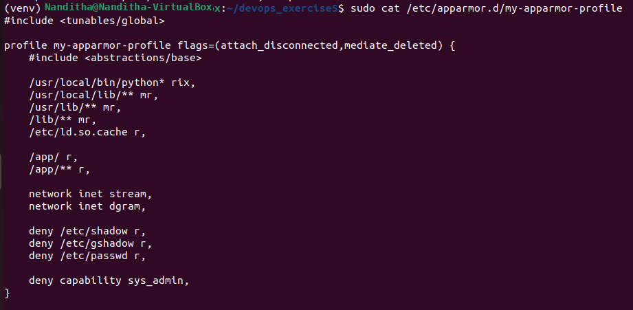
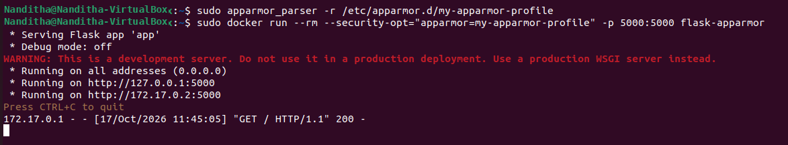
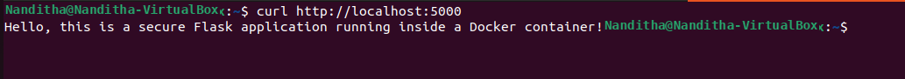
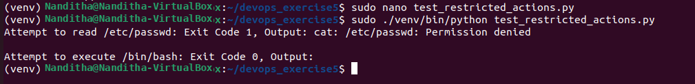

# Docker Security with AppArmor and Python — Lab Report

## Objective

Secure a Docker container running a Python Flask application by applying an AppArmor profile, applying the profile through the Docker SDK for Python, and testing whether restricted actions inside the container are blocked.

## Environment

| Item | Value |
|---|---|
| OS | Ubuntu running in VirtualBox |
| Container runtime | Docker Engine |
| Application | Python Flask |
| Python environment | Virtual environment (`venv`) |
| Security mechanism | AppArmor |
| Automation | Docker SDK for Python |

## Scenario

A Flask web application runs inside a Docker container. An AppArmor profile is loaded into the host kernel and supplied to Docker when the container starts. The profile denies reads of selected sensitive files and denies the `CAP_SYS_ADMIN` capability. The Docker SDK is used to configure a container and test the restrictions.

---

## Prerequisites

```bash
sudo apt-get update
sudo apt-get install -y apparmor-utils
pip install flask docker
```

`apparmor-utils` provides `apparmor_parser`, which loads AppArmor profiles into the kernel. The `docker` package provides the Docker SDK for Python.

## Task 1: Create a Flask application

Create `app.py`:

```python
from flask import Flask

app = Flask(__name__)

@app.route("/")
def home():
    return "Hello, this is a secure Flask application running inside a Docker container!"

if __name__ == "__main__":
    app.run(host="0.0.0.0", port=5000)
```

The application exposes one route (`/`) on port 5000 and listens on all container interfaces.

## Task 2: Containerize the application

Create a file named `Dockerfile`:

```dockerfile
FROM python:3.8-slim
WORKDIR /app
COPY . /app
RUN pip install flask
EXPOSE 5000
CMD ["python", "app.py"]
```

Build the image:

```bash
sudo docker build -t flask-apparmor .
```

The image is named `flask-apparmor`.

## Task 3: Create and load the AppArmor profile

Create the profile file:

```bash
sudo nano /etc/apparmor.d/my-apparmor-profile
```

Profile contents:

```text
#include <tunables/global>

profile my-apparmor-profile flags=(attach_disconnected,mediate_deleted) {
    #include <abstractions/base>

    /usr/local/bin/python* rix,
    /usr/local/lib/** mr,
    /usr/lib/** mr,
    /lib/** mr,
    /etc/ld.so.cache r,

    /app/ r,
    /app/** r,

    network inet stream,
    network inet dgram,

    deny /etc/shadow r,
    deny /etc/gshadow r,
    deny /etc/passwd r,

    deny capability sys_admin,
}
```



### Key rules

| Rule | Purpose |
|---|---|
| `#include <abstractions/base>` | Includes common baseline AppArmor rules. |
| `/usr/local/bin/python* rix,` | Allows matching Python executables to be executed with inherited profile permissions. |
| Library rules with `mr` | Allow reading and memory-mapping required library files. |
| `/app/` and `/app/**` | Allow access to the application directory and its contents. |
| `network inet stream` / `network inet dgram` | Allow IPv4 stream and datagram socket operations. |
| `deny /etc/shadow r,` | Denies reading `/etc/shadow`. |
| `deny /etc/gshadow r,` | Denies reading `/etc/gshadow`. |
| `deny /etc/passwd r,` | Denies reading `/etc/passwd`. |
| `deny capability sys_admin,` | Denies the `CAP_SYS_ADMIN` capability. |

Load the profile:

```bash
sudo apparmor_parser -r /etc/apparmor.d/my-apparmor-profile
```

The command returned without displaying an error.

### Run the container with the profile

```bash
sudo docker run --rm \
  --security-opt="apparmor=my-apparmor-profile" \
  -p 5000:5000 \
  flask-apparmor
```

Flask started and listened on `0.0.0.0:5000`.



### Verify the Flask endpoint

In a second terminal, run:

```bash
curl http://localhost:5000
```

Observed response:

```text
Hello, this is a secure Flask application running inside a Docker container!
```

The screenshot also shows the successful HTTP request in the Flask log.



## Task 4: Apply the profile through the Docker SDK for Python

Create `apply_apparmor.py`:

```python
import docker

client = docker.from_env()

print("Building image from Dockerfile...")
client.images.build(path=".", tag="flask-apparmor")

print("Running container with AppArmor profile...")
container = client.containers.run(
    "flask-apparmor",
    ports={"5000/tcp": 5000},
    security_opt=["apparmor=my-apparmor-profile"],
    detach=True,
)

try:
    print(f"Container started: {container.short_id}")
    info = client.api.inspect_container(container.id)
    print("AppArmor security options:", info["HostConfig"]["SecurityOpt"])
    print("Active AppArmor profile:", info.get("AppArmorProfile"))
finally:
    print("Stopping the container...")
    container.stop(timeout=5)
    container.remove()
    print("Container stopped.")
```

Run the script from the project directory:

```bash
sudo ./venv/bin/python apply_apparmor.py
```

The script builds the image, starts a container with the requested security option, inspects its configuration, and stops and removes it in the `finally` block. Docker's `HostConfig.SecurityOpt` can be inspected to verify the configured security option.

## Task 5: Test restricted actions

Create `test_restricted_actions.py`:

```python
import docker

client = docker.from_env()

container = client.containers.run(
    "flask-apparmor",
    ports={"5000/tcp": 5000},
    security_opt=["apparmor=my-apparmor-profile"],
    detach=True,
)

try:
    exit_code, output = container.exec_run("cat /etc/passwd")
    print(
        "Attempt to read /etc/passwd: "
        f"Exit Code {exit_code}, Output: {output.decode().strip()}"
    )

    exit_code, output = container.exec_run("/bin/bash")
    print(
        "Attempt to execute /bin/bash: "
        f"Exit Code {exit_code}, Output: {output.decode().strip()}"
    )
finally:
    container.stop()
    container.remove()
```

Run the test:

```bash
sudo ./venv/bin/python test_restricted_actions.py
```

Observed output from the supplied screenshot:

```text
Attempt to read /etc/passwd: Exit Code 1, Output: cat: /etc/passwd: Permission denied
Attempt to execute /bin/bash: Exit Code 0, Output:
```



### Interpretation

- **Reading `/etc/passwd`: blocked.** The command returned exit code 1 and `Permission denied`, consistent with the explicit AppArmor deny rule.
- **Executing `/bin/bash`: not shown to be blocked.** The recorded exit code is 0 and there is no denial message. This test does not demonstrate that Bash execution was prevented. The profile does not include an explicit deny rule for `/bin/bash`; do not report this test as a successful block.
- The `/etc/passwd` result is the confirmed restriction demonstrated by the supplied output.

## Results summary

| Test | Expected / purpose | Observed result |
|---|---|---|
| Load profile using `apparmor_parser -r` | Profile loads without errors | Command returned without an error |
| Start Flask with AppArmor | Application starts under the profile | Flask started on port 5000 |
| Request `http://localhost:5000` | Application responds | Greeting returned; HTTP 200 shown in server log |
| Configure profile through Docker SDK | Security option is passed to Docker | Script uses `security_opt=["apparmor=my-apparmor-profile"]` and inspects container configuration |
| Read `/etc/passwd` | Access is denied | `Permission denied`, exit code 1 |
| Execute `/bin/bash` | Check whether execution is denied | Exit code 0; restriction was **not demonstrated** |

## Observations

1. The Flask endpoint continued to respond while the explicit `/etc/passwd` read was denied.
2. AppArmor applies mandatory access-control rules at the host-kernel level to processes running in the container.
3. The Docker SDK can pass the profile using `security_opt` and inspect the resulting container configuration.
4. The profile name supplied to Docker must match a profile loaded into AppArmor.
5. The Flask development-server warning is expected for this simple lab. A production deployment should use a production WSGI server, such as Gunicorn.

## Conclusion

The lab demonstrates loading an AppArmor profile, running a Flask container with that profile, checking the endpoint, and using the Docker SDK to configure container security. The supplied test confirms that reading `/etc/passwd` is denied. The Bash test returned exit code 0, so it should not be presented as evidence that executing Bash was blocked.
