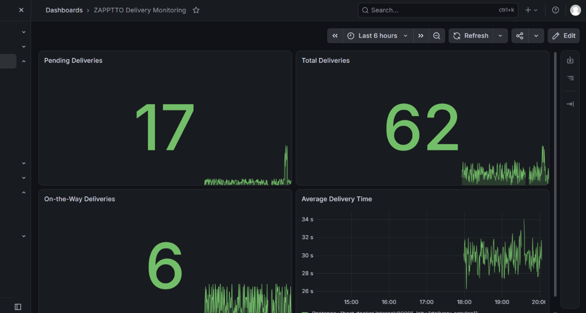
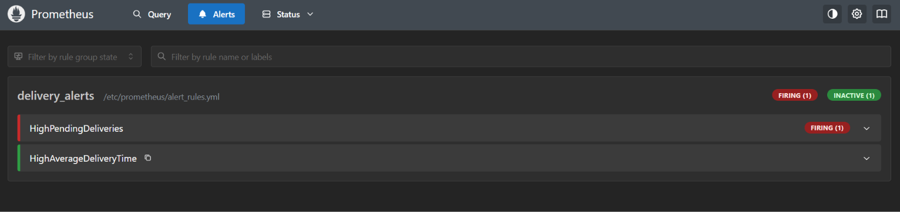
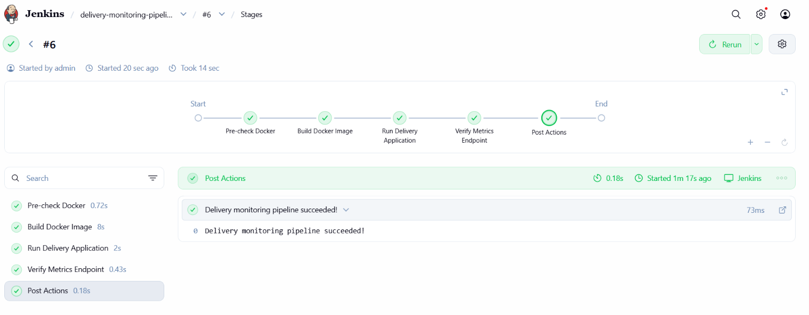

# Real-Time Operations Monitoring and Alerting

A local DevOps lab that simulates delivery-service metrics, exposes them from a Python application, scrapes them with Prometheus, visualizes them in Grafana, evaluates alert rules, and uses a Jenkins Pipeline to build and run the application container.

> **Scope:** This is a learning/demo project. The delivery metrics are randomly generated; they are not connected to a real delivery platform.

## Architecture

```text
Python delivery simulator
        │  /metrics on port 8000
        ▼
    Prometheus ───── evaluates alert rules
        │
        ▼
     Grafana dashboard

Jenkins Pipeline ── builds the Docker image, runs the app container,
                    and verifies that the metrics endpoint responds
```

## Technology stack

- Python 3.11 and `prometheus-client`
- Docker Desktop
- Prometheus
- Grafana
- Jenkins Pipeline
- PowerShell on Windows

## Metrics

| Metric | Type | Meaning |
|---|---|---|
| `total_deliveries` | Gauge | Simulated total deliveries in the current sample |
| `pending_deliveries` | Gauge | Number of pending deliveries in the current sample |
| `on_the_way_deliveries` | Gauge | Number of deliveries on the way in the current sample |
| `average_delivery_time` | Summary | Observations of simulated delivery time in seconds; Prometheus exposes `_sum` and `_count` series |

The simulator generates a new sample every second. The gauges can rise or fall; the Summary's sum and count accumulate observations while the process is running.

## Grafana dashboard

The dashboard contains four panels: total deliveries, pending deliveries, on-the-way deliveries, and average delivery time.



## Prometheus alerts

The configured rules are:

- **`HighPendingDeliveries`** — fires when `pending_deliveries > 10` remains true for 15 seconds; severity `warning`.
- **`HighAverageDeliveryTime`** — fires when `(average_delivery_time_sum / average_delivery_time_count) > 30`; severity `critical`.

The screenshot below records the pending-delivery rule firing during testing. The average-time alert is inactive in this captured state; it can be tested by temporarily raising the simulated delivery times above 30 seconds and rebuilding/restarting the app.



## Jenkins pipeline

The Jenkins Pipeline performs these stages:

1. **Pre-check Docker** — verifies Docker client and engine access.
2. **Build Docker Image** — builds the `delivery_metrics` image from the project Dockerfile.
3. **Run Delivery Application** — replaces and starts the application container on port 8000.
4. **Verify Metrics Endpoint** — retries the `/metrics` endpoint check.
5. **Post Actions** — prints a success or failure message.

The screenshot shows a successful pipeline run (build `#6`).



## Project files

```text
delivery_monitoring/
├── delivery_metrics.py
├── Dockerfile
├── Dockerfile.jenkins
├── prometheus.yml
├── alert_rules.yml
└── README.md
```

## Run locally

### 1. Install the Python dependency

From PowerShell in the project directory:

```powershell
python -m venv .venv
.\.venv\Scripts\Activate.ps1
python -m pip install prometheus-client
```

### 2. Run the metrics app

```powershell
python delivery_metrics.py
```

Keep this terminal open. Check the endpoint at <http://localhost:8000/metrics>.

### 3. Run Prometheus in Docker

The provided `prometheus.yml` should scrape the Python app at `host.docker.internal:8000` and Prometheus itself at `localhost:9090` from within its container. Run this command from the project directory:

```powershell
docker run -d --name prometheus -p 9090:9090 --add-host=host.docker.internal:host-gateway -v "${PWD}/prometheus.yml:/etc/prometheus/prometheus.yml" -v "${PWD}/alert_rules.yml:/etc/prometheus/alert_rules.yml" prom/prometheus
```

Open <http://localhost:9090/targets> and verify that `delivery_service` is **UP**. View rules at <http://localhost:9090/alerts>.

### 4. Run Grafana in Docker

```powershell
docker run -d --name grafana -p 3000:3000 grafana/grafana
```

Open <http://localhost:3000>. Add a Prometheus data source with URL `http://host.docker.internal:9090`, then create a dashboard using the metrics listed above. Use a recent-window mean for the average-time graph if desired:

```promql
rate(average_delivery_time_sum[1m]) / rate(average_delivery_time_count[1m])
```

### 5. Build the application image

```powershell
docker build -t delivery_metrics .
```

### 6. Jenkins setup used in this lab

`Dockerfile.jenkins` builds a Jenkins image with the Docker CLI and Pipeline plugins. From the project directory:

```powershell
docker build -f Dockerfile.jenkins -t myjenkins:lts .
```

For this local lab, Jenkins was run with access to Docker Desktop and the project directory mounted at `/workspace`:

```powershell
docker run -d --name jenkins --group-add 0 -p 8080:8080 -p 50000:50000 -v jenkins_home:/var/jenkins_home -v /var/run/docker.sock:/var/run/docker.sock -v "${PWD}:/workspace" myjenkins:lts
```

Create a Pipeline job in Jenkins and use this script:

```groovy
pipeline {
    agent any

    stages {
        stage('Pre-check Docker') {
            steps {
                sh 'docker version'
                sh 'docker info'
            }
        }

        stage('Build Docker Image') {
            steps {
                sh 'docker build -t delivery_metrics -f /workspace/Dockerfile /workspace'
            }
        }

        stage('Run Delivery Application') {
            steps {
                sh '''
                    docker rm -f delivery_metrics >/dev/null 2>&1 || true
                    docker run -d --name delivery_metrics -p 8000:8000 delivery_metrics
                '''
            }
        }

        stage('Verify Metrics Endpoint') {
            steps {
                sh '''
                    for i in $(seq 1 15); do
                        if curl -fsS http://host.docker.internal:8000/metrics >/dev/null; then
                            echo "Metrics endpoint is responding"
                            exit 0
                        fi
                        sleep 2
                    done
                    echo "Metrics endpoint verification failed"
                    exit 1
                '''
            }
        }
    }

    post {
        success {
            echo 'Delivery monitoring pipeline succeeded!'
        }
        failure {
            echo 'Pipeline failed. Check the Console Output.'
        }
    }
}
```

> **Security note:** Mounting `/var/run/docker.sock` into Jenkins gives the Jenkins process powerful control over Docker Desktop. This setup is intended only for a local practice environment, not a production Jenkins deployment.

## Useful URLs while the containers are running

- Python metrics: <http://localhost:8000/metrics>
- Prometheus targets: <http://localhost:9090/targets>
- Prometheus alerts: <http://localhost:9090/alerts>
- Grafana: <http://localhost:3000>
- Jenkins: <http://localhost:8080>

## Clean up

Stop the lab containers without deleting the images or Jenkins configuration volume:

```powershell
docker stop delivery_metrics grafana prometheus jenkins
```

Start them again later with:

```powershell
docker start jenkins prometheus grafana delivery_metrics
```

Keep the `jenkins_home` volume if you want to preserve the Jenkins job and account.
