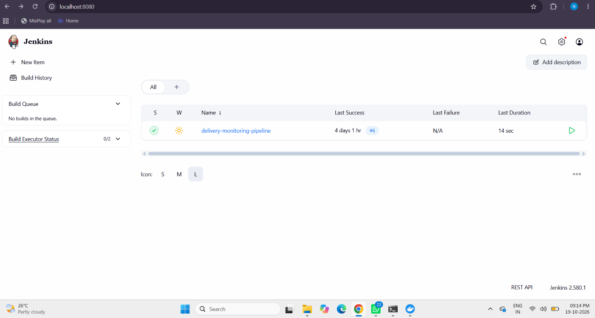
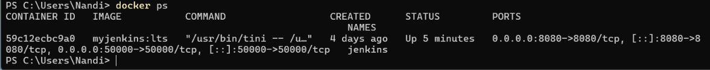
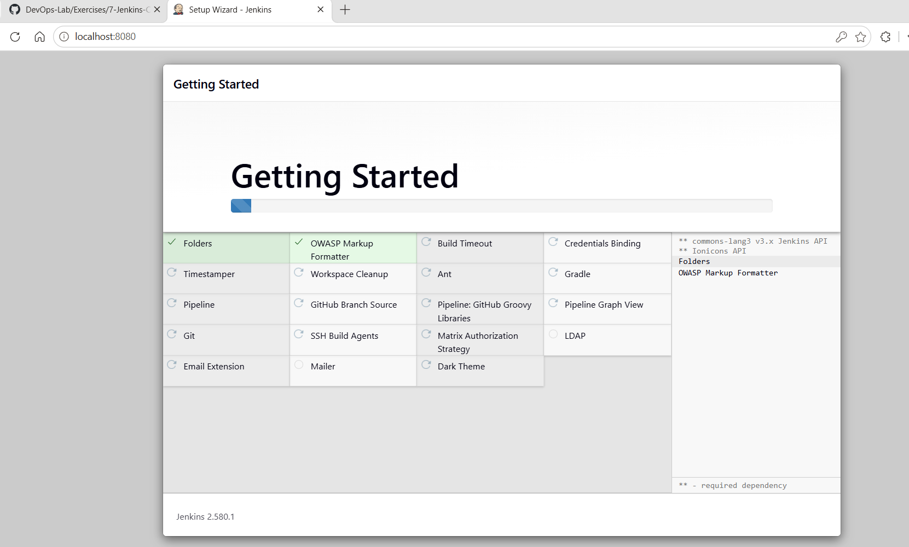

# Introduction to Continuous Integration (CI) and Jenkins Installation

## 1. What is Continuous Integration (CI)?

Continuous Integration (CI) is a software development practice in which developers frequently merge code changes into a shared repository. Automated builds and tests help detect integration issues early and provide quick feedback.

## 2. Key Features of CI

- **Frequent code integration:** Developers regularly commit changes to a shared repository.
- **Automated builds:** Code is built automatically when changes are submitted.
- **Automated testing:** Tests check that new changes do not break existing functionality.
- **Immediate feedback:** Build and test results help developers identify problems quickly.

## 3. Benefits of CI

- Early detection of defects and integration problems.
- Improved collaboration across a development team.
- Faster development and feedback cycles.
- Better software quality through repeatable automated checks.

## 4. CI Workflow

1. A developer changes code and pushes it to a version-control repository.
2. The CI server detects the change or receives a build trigger.
3. The server checks out the code and runs the configured build.
4. Automated tests run.
5. The server reports whether the build and tests succeeded or failed.

## 5. Examples of CI/CD Tools

| Tool | Overview |
|---|---|
| Jenkins | Open-source automation server with a large plugin ecosystem. |
| GitHub Actions | Workflow automation integrated with GitHub repositories. |
| GitLab CI/CD | Pipeline automation integrated with GitLab. |
| CircleCI | CI/CD platform supporting containerized workflows. |
| Azure Pipelines | CI/CD service in the Azure DevOps ecosystem. |
| TeamCity | CI/CD server from JetBrains. |
| Bamboo | Atlassian CI/CD tool that integrates with its ecosystem. |

## 6. Introduction to Jenkins

Jenkins is an open-source automation server used to automate tasks such as building, testing, and deploying software. It supports Continuous Integration and Continuous Delivery through jobs, pipelines, and plugins.

### Key Jenkins concepts

- **Job:** A configured task that Jenkins executes.
- **Build:** One execution of a job or pipeline.
- **Pipeline:** A sequence of automated steps defined in a Jenkinsfile or job configuration.
- **Plugins:** Extensions that add integrations and functionality.
- **Controller and agents:** The controller coordinates jobs; agents can execute work on other machines.

## 7. Install Jenkins using Docker

### Prerequisites

- Docker Desktop installed and running.
- PowerShell or another terminal.
- A browser for accessing the Jenkins dashboard.

### Start the Jenkins container

Run in PowerShell:

```powershell
docker run -d --name jenkins -p 8080:8080 -p 50000:50000 jenkins/jenkins:lts
```

This command downloads the Jenkins LTS image if necessary and starts a container.

- `-d` runs the container in the background.
- `--name jenkins` gives the container a name.
- `-p 8080:8080` exposes the Jenkins web interface on local port 8080.
- `-p 50000:50000` publishes the inbound agent port.

> If Docker reports that the name `jenkins` is already in use, check the existing container instead of creating another one.

### Verify the container

```powershell
docker ps
```

The Jenkins container should appear with a status such as `Up ...` and a port mapping for `8080`.

### Retrieve the initial administrator password

```powershell
docker exec jenkins cat /var/jenkins_home/secrets/initialAdminPassword
```

Copy the password from the terminal and enter it on the Jenkins **Unlock Jenkins** page. Do not publish this password or commit it to source control.

### Finish the setup wizard

1. Open [http://localhost:8080](http://localhost:8080).
2. Enter the initial administrator password if prompted.
3. Select **Install suggested plugins**.
4. Wait for the plugins to install.
5. Create an administrator account if the setup wizard asks for one.
6. Keep `http://localhost:8080/` as the local Jenkins URL.
7. Click **Save and Finish** and then **Start using Jenkins**, if shown.

## 8. Installation Verification

The Docker container was verified using `docker ps`. The Jenkins dashboard was accessible at `http://localhost:8080/`.

The dashboard screenshot also shows an existing job named `delivery-monitoring-pipeline` with a successful build (`#6`). This is evidence of an existing Jenkins job; it is not a newly created job in this installation exercise.

## 9. Screenshots

### Jenkins dashboard



### Docker container verification



### Jenkins setup wizard / plugin installation



## 10. Conclusion

Jenkins was available locally through Docker at `http://localhost:8080/`. The container status and dashboard were checked, completing the Jenkins installation verification exercise.
