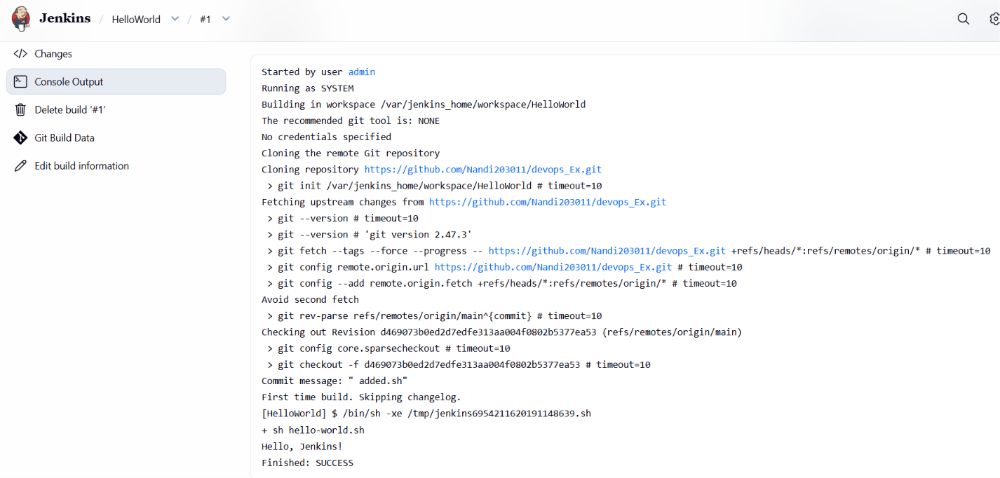

# Creating a "Hello World" Jenkins Job

## Objective

Create a Jenkins Freestyle job that retrieves a shell script from GitHub, executes it, and displays `Hello, Jenkins!` in the console output.

## Prerequisites

- Jenkins is running at `http://localhost:8080`.
- A GitHub repository contains the `hello-world.sh` script.

## Step 1: Create the Shell Script

Create a file named `hello-world.sh` in your GitHub repository with the following content:

```bash
#!/bin/bash
echo "Hello, Jenkins!"
```

Commit and push the file to GitHub.

## Step 2: Create a Jenkins Job

1. Open `http://localhost:8080` and sign in.
2. Click **New Item** on the Jenkins dashboard.
3. Enter `HelloWorld` as the job name.
4. Select **Freestyle project**.
5. Click **OK**.

## Step 3: Configure Source Code Management

1. Find the **Source Code Management** section.
2. Select **Git**.
3. Enter the HTTPS URL of the GitHub repository containing `hello-world.sh`.

   ```text
   https://github.com/YOUR_USERNAME/YOUR_REPOSITORY.git
   ```

4. Set the branch to `*/main`, if applicable.
5. Leave credentials as **None** if the repository is public.

## Step 4: Configure the Build Step

1. Under **Build Steps**, click **Add build step**.
2. Select **Execute shell**.
3. Enter the following command:

   ```bash
   sh hello-world.sh
   ```

4. Click **Save**.


### Step 5: Configure the Job

Open the `HelloWorld` job configuration and set the following options.

- **Description:** `Hello World! Jenkins job.`

- **Source Code Management:** Select **Git**.
  - **Repository URL:** `https://github.com/Nandi203011/devops_Ex.git`
  - **Credentials:** None, since the repository is public.
  - **Branch Specifier:** `*/main`

- **Build Steps:** Select **Add build step → Execute shell** and enter:

  ```bash
  sh Ex8/hello-world.sh
  ```

Click **Save** to save the configuration.

**Note:** The script path is relative to the root of the checked-out repository. Ensure that `hello-world.sh` exists at `hello-world.sh` in your GitHub repository.


## Step 6: Verify the Output

The successful build displays output similar to:

```text
+ sh hello-world.sh
Hello, Jenkins!
Finished: SUCCESS
```

The expected message confirms that the shell script executed successfully.

### Console Output Screenshot




## Result

The `HelloWorld` Jenkins Freestyle job successfully retrieved the source code from GitHub, executed `hello-world.sh`, printed `Hello, Jenkins!`, and finished with `SUCCESS`.